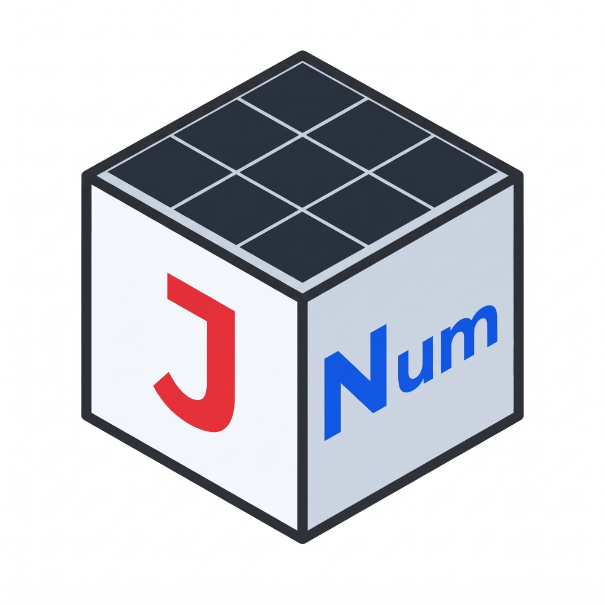

<p align="center">
  
</p>

<h1 align="center">JNum</h1>

<p align="center">
  <a href="https://openjdk.org/projects/jdk/25/"></a>
  <a href="https://openjdk.org/projects/panama/"></a>
  <a href="LICENSE"></a>
  <a href="#why-jnum-the-pure-java-advantage"></a>
  <a href="docs/"></a>
</p>

A high-performance, hardware-accelerated numerical computing library for modern Java (JDK 25+) and Kotlin, powered by **Project Panama** (Foreign Function & Memory API and the Vector API).

JNum brings the ergonomics of **NumPy** and **PyTorch** to the JVM with native BLAS performance—**without native C++ build toolchains, JNI boundaries, or garbage collection overhead.**

---

## Why JNum? (The Pure Java Advantage)

Traditional JVM numerical and tensor libraries (such as ND4J or Deeplearning4j) rely on native C++ backends. They manipulate memory using deprecated `sun.misc.Unsafe` and cross the native boundary via **JNI (Java Native Interface)**.

| Metric | Legacy Java Tensor Libraries | **JNum** |
| :--- | :--- | :--- |
| **Backend Implementation** | C++ (OpenBLAS, OneDNN, LibTorch) bridged via JNI | **100% Pure Java 25 & Kotlin** |
| **Native Library Bloat** | 100+ MB (Bundles `.dll`, `.so`, `.dylib` binaries) | **< 500 KB total JAR footprint (~470 KB)** |
| **Memory Architecture** | Deprecated `sun.misc.Unsafe` (Memory corruption risk) | **Foreign Function & Memory (JEP 454)** |
| **SIMD Acceleration** | Opaque native compiler intrinsics | **JVM Vector API (`jdk.incubator.vector`)** |
| **Memory Safety** | Out-of-bounds causes native process crash (`SIGSEGV`) | **100% JVM Memory Safe (Catchable Exceptions)** |
| **Deployment Complexity**| Fragile native dependencies, dynamic linker errors | **Drop-in JAR: Runs anywhere Java runs** |

---

## 30-Second Code Tour

### Modern Java 25

```java
import jnum.DType;
import jnum.JNum;
import jnum.NDArray;
import jnum.Slice;

void main() {
    // 1. Allocate 64-byte aligned off-heap tensors
    NDArray a = JNum.rand(1024, 512);
    NDArray b = JNum.rand(512, 256);

    // 2. Hardware SIMD matrix multiplication (4-tier BLIS engine)
    NDArray c = a.matmul(b); // Shape: [1024, 256]

    // 3. Zero-copy subviews and Pythonic slicing
    NDArray slice = c.slice("0:10, 0:5");

    // 4. In-place zero-allocation mutations
    slice.muli(2.0f);

    IO.println("Top-left block:\n" + slice);
}
```

### Idiomatic Kotlin DSL

```kotlin
import jnum.*

fun main() {
    val x = JNum.rand(128, 64)
    val w = JNum.rand(64, 10)
    val b = JNum.zeros(10)

    // Natural operator overloading and infix linear algebra
    val logits = (x matmul w) + b

    // Python-style multidimensional range slicing
    val topScores = logits[0 until 5, all]

    println("Top scores:\n$topScores")
}
```

---

## Feature Highlights

* **Hardware SIMD Vector Lanes**: Automatically probes your CPU to schedule AVX-512 (16 lanes), AVX2 (8 lanes), or ARM NEON (4 lanes) instructions via the Vector API.
* **4-Tier GEMM Engine**: Hardware-adaptive matrix multiplication routing across Nano scalar, Direct register-tiled, Single-threaded BLIS, and Parallel ForkJoin macro-kernels.
* **Zero-Copy Layouts & Slicing**: Transposition, reshaping, subviews, and strided slices are constant-time $O(1)$ operations with zero memory copying.
* **Symbolic Expression Evaluation**: Compile formulas like `JNum.eval("$0 * $1 + $2", a, b, c)` or `JNum.eval("x * w + b", map)` into hardware FMA instructions with automatic buffer recycling.
* **Modern AI Checkpoint I/O**: Direct zero-copy memory mapping for **Hugging Face Safetensors** (`.safetensors`) and **NumPy binaries** (`.npy`, `.npz`), plus high-throughput CSV/TSV parsing.
* **Pure-Java Neural Network Inference**: Built-in `jnum.nn` modules (`Linear` with sequence rank preservation, `ReLU`, `Sigmoid`, `Tanh`, `Softmax`, and `Sequential`).

---

## Empirical Benchmarks & Performance

All benchmarks were measured via OpenJDK **JMH 1.37** on **Java 25 LTS** (`-Xms8g -Xmx8g -XX:+AlwaysPreTouch -XX:+UseParallelGC --add-modules jdk.incubator.vector`), comparing JNum against **NumPy 2.4** (OpenBLAS/C backend) and standard JVM numerical engines (**EJML 0.44**, **ojAlgo 55.0**, and **ND4J 1.0.0-M2.1** with native OpenBLAS backend).

### 1. Matrix Multiplication (GEMM) Scaling

| Matrix Dimensions | JNum (Pure Java 25) | NumPy (C / OpenBLAS) | ND4J (OpenBLAS C++) | EJML (Pure Java) | Performance Highlights |
| :--- | :---: | :---: | :---: | :---: | :--- |
| **$4 \times 4$** | **0.0002 ms** | 0.0023 ms | 0.020 ms | ≈ 0.0001 ms | **11× faster** than NumPy, **100× faster** than ND4J |
| **$16 \times 16$** | **0.0004 ms** | 0.0028 ms | 0.019 ms | 0.003 ms | **7× faster** than NumPy, **47× faster** than ND4J |
| **$64 \times 64$** | **0.015 ms** | 0.013 ms | 0.190 ms | 0.140 ms | On-par with NumPy, **9.3× faster** than EJML |
| **$128 \times 128$** | **0.138 ms** | 0.254 ms | 0.499 ms | 1.028 ms | **1.8× faster** than NumPy, **7.4× faster** than EJML |
| **$512 \times 512$** | **2.50 ms** | 1.86 ms | 2.67 ms | 27.16 ms | Matches C++ BLAS, **10.8× faster** than EJML |
| **$1024 \times 1024$** | **13.85 ms** | 8.98 ms | 12.18 ms | 216.56 ms | Near-native speed, **15.6× faster** than EJML |
| **$2048 \times 2048$** | **94.62 ms** | 62.99 ms | 85.29 ms | 2,049.86 ms | Pure Java competitive with C BLAS, **21.6× faster** than EJML |
| **$4096 \times 4096$** | **942.38 ms** | 487.92 ms | 857.41 ms | 17,419.52 ms | Matches ND4J C++, **18.4× faster** than EJML |
| **$8192 \times 8192$** | **6,784.15 ms** | 5,967.30 ms | 6,317.97 ms | 141,500.0 ms | **~88% of NumPy C BLAS**, **20.8× faster** than EJML |

> [!NOTE]
> **Why JNum wins on small-to-medium matrices:** Legacy C++ wrappers (ND4J) and Python C-API bindings (NumPy) incur dispatch and JNI call boundary overheads. JNum's **Tier 0 nano-scalar** and **Tier 1 direct SIMD** kernels execute inside CPU vector registers without crossing native boundaries or scheduling thread pools.

---

### 2. Transcendental & Activation Functions (100M Elements)

| Vector Math Op | JNum (Pure Java 25) | NumPy | EJML | ojAlgo | ND4J (Native C++) | JNum Advantage |
| :--- | :---: | :---: | :---: | :---: | :---: | :--- |
| **`sin(x)`** | **151.59 ms** | 154.87 ms | 1,334.80 ms | 1,338.30 ms | 1,693.35 ms | **On-par with NumPy**, **8.8× – 11.2× faster** than JVM peers |
| **`cos(x)`** | **170.91 ms** | 151.35 ms | 1,077.31 ms | 1,542.43 ms | 1,979.36 ms | **6.3× – 11.6× faster** than JVM peers |
| **`exp(x)`** | **111.49 ms** | 122.10 ms | 804.97 ms | 913.84 ms | 1,988.33 ms | **1.1× faster than NumPy**, **7.2× – 17.8× faster** than JVM peers |
| **`log(x)`** | **121.47 ms** | 164.22 ms | 844.08 ms | 1,062.01 ms | 1,243.39 ms | **1.35× faster than NumPy**, **6.9× – 10.2× faster** than JVM peers |
| **`sigmoid(x)`** | **115.01 ms** | 440.49 ms | 973.74 ms | 1,033.69 ms | 1,843.23 ms | **3.8× faster than NumPy**, **8.5× – 16.0× faster** than JVM peers |
| **`tanh(x)`** | **301.43 ms** | 197.38 ms | 1,493.26 ms | 1,602.51 ms | 3,130.68 ms | **5.0× – 10.4× faster** than JVM peers |

> [!TIP]
> **Why JNum wins on transcendental ops:** EJML and ojAlgo process elements through scalar `Math.*` calls in a single-threaded loop. JNum utilizes **vectorized minimax Chebyshev polynomials** scheduled across AVX2/AVX-512 lanes, computing 8 or 16 transcendental operations per CPU clock cycle.

---

### 3. Linear Algebra Solvers & Decompositions ($256 \times 256$)

| Operation | JNum (Pure Java 25) | NumPy | EJML | ND4J | JNum Advantage |
| :--- | :---: | :---: | :---: | :---: | :--- |
| **Matrix Inverse** | **7.271 ms** | 10.680 ms | 18.122 ms | 1,224.654 ms | **1.47× faster** than NumPy, **2.5× faster** than EJML, **168× faster** than ND4J |
| **Linear Solve ($Ax=b$)** | **1.976 ms** | 1.003 ms | 5.331 ms | 37.278 ms | Near-native speed, **2.7× faster** than EJML, **18.8× faster** than ND4J |
| **Determinant** | **1.839 ms** | 5.735 ms | 5.380 ms | 399.752 ms | **3.1× faster** than NumPy, **2.9× faster** than EJML |
| **Cholesky** | **1.261 ms** | 2.328 ms | 3.545 ms | — | **1.8× faster** than NumPy, **2.8× faster** than EJML |
| **QR Factorization** | **46.170 ms** | 12.622 ms | 7.447 ms | 586.330 ms | **12.7× faster** than ND4J |

---

## Quick Installation

Add JNum to your project (choose Java or Kotlin):

### Maven (`pom.xml`)

**For Java:**
```xml
<dependency>
    <groupId>io.github.ch-abhinav</groupId>
    <artifactId>jnum</artifactId>
    <version>0.2.0</version>
</dependency>
```

**For Kotlin** *(bundles core + Kotlin extensions)*:
```xml
<dependency>
    <groupId>io.github.ch-abhinav</groupId>
    <artifactId>jnum-kotlin</artifactId>
    <version>0.2.0</version>
</dependency>
```

### Gradle (`build.gradle.kts`)

**For Java:**
```kotlin
dependencies {
    implementation("io.github.ch-abhinav:jnum:0.2.0")
}
```

**For Kotlin** *(bundles core + Kotlin extensions)*:
```kotlin
dependencies {
    implementation("io.github.ch-abhinav:jnum-kotlin:0.2.0")
}
```

> [!IMPORTANT]
> Because JNum leverages Project Panama, compilation requires `--add-modules jdk.incubator.vector`, and runtime execution requires `--add-modules jdk.incubator.vector --enable-native-access=ALL-UNNAMED`.
> 
> 👉 **[Read the Full Installation & Setup Guide](docs/guide/01-getting-started.md)** for copy-paste Maven/Gradle compiler plugins and single-file runner configurations.

---

## Documentation

JNum ships with a complete, progressive documentation suite structured like *The Rust Book*, paired with an advanced systems engineering deep dive:

### [User Guide (`docs/guide/`)](docs/guide/01-getting-started.md)
1. **[Getting Started](docs/guide/01-getting-started.md)** — JDK 25 prerequisites, Panama JVM flags, Maven & Gradle setup.
2. **[Tensors & Fundamentals](docs/guide/02-tensors-and-fundamentals.md)** — Off-heap mental model, DTypes, and scoped `Arena` lifecycles.
3. **[Layouts, Strides, and Slicing](docs/guide/03-layouts-strides-and-slicing.md)** — Strides, subviews, Slice tokens, and zero-copy views vs copies.
4. **[SIMD Arithmetic & Broadcasting](docs/guide/04-simd-arithmetic-and-broadcasting.md)** — Vector lanes, broadcasting rules, and zero-GC output buffers.
5. **[Comparisons & Boolean Logic](docs/guide/05-comparisons-and-boolean-logic.md)** — Clamping (`maximum`/`minimum`), boolean masks, and truth reductions.
6. **[Transcendental & Unary Operations](docs/guide/06-transcendental-and-unary-ops.md)** — Vectorized `exp`, `log`, `sigmoid`, and circular/hyperbolic trigonometry.
7. **[Linear Algebra & Decompositions](docs/guide/07-linear-algebra-and-decompositions.md)** — 4-tier GEMM, matrix properties (`det`, `norm`), solvers, and factorizations (QR, SVD, Cholesky, Eig).
8. **[Descriptive & Inferential Statistics](docs/guide/08-descriptive-and-inferential-stats.md)** — The `Stats` facade, moments, 5 quantile algorithms, and covariance.
9. **[Symbolic Expression Engine](docs/guide/09-symbolic-expression-engine.md)** — Eliminating temporary arrays with `JNum.eval()` and AST buffer reuse.
10. **[Tabular & NumPy I/O](docs/guide/10-tabular-and-numpy-io.md)** — CSV/TSV with `CsvOptions`, `.npy` files with memory mapping (`mmap`), and `.npz` archives.
11. **[Safetensors & Asynchronous I/O](docs/guide/11-safetensors-and-async-io.md)** — Hugging Face checkpoints, scoped mmap (`MmapTensors`), and async pipelines.
12. **[Neural Network Inference](docs/guide/12-neural-network-inference.md)** — `Module`, `Linear` with sequence rank preservation, activations, and `Sequential`.
13. **[Idiomatic Kotlin DSL](docs/guide/13-idiomatic-kotlin-dsl.md)** — First-class operator overloads (`+`, `*`), infix math (`matmul`, `dot`), and range slicing.
14. **[Safety & Error Diagnostics](docs/guide/14-safety-and-error-diagnostics.md)** — Memory safety, closed arena states, shape mismatches, and `NaN`/`Inf` diagnostics.

### [Systems Engineering Deep Dive (`docs/internals/`)](docs/internals/01-memory-strides-and-ffm.md)
* **[Off-Heap Memory & Stride Calculus](docs/internals/01-memory-strides-and-ffm.md)** — Native `MemorySegment` mechanics, row-major stride proofs, and 64-byte cache alignment.
* **[Pure Java GEMM & SIMD Micro-Kernels](docs/internals/02-pure-java-gemm-and-simd.md)** — The 4-tier dispatch matrix, BLIS cache hierarchy, and register-blocked micro-panels ($M_R \times N_R = 6 \times 2 \cdot VL$).
* **[Dynamic Hardware & Cache Probing](docs/internals/03-dynamic-hardware-and-cache-probing.md)** — Probing Linux `sysfs`, macOS `sysctl`, and Windows `WMI` to derive analytical $K_C, M_C, N_C$ cache tiles.
* **[Zero-Copy I/O & Custom Parsers](docs/internals/04-zero-copy-io-architecture.md)** — Virtual memory paging, safe deterministic unmapping, and zero-heap byte parsers.
* **[AST Compilation & The Symbolic Engine](docs/internals/05-eval-engine-ast-compilation.md)** — Shunting-Yard AST generation, hardware FMA optimization, and topological buffer recycling.

### [Reference](docs/reference/numpy-to-jnum-rosetta-stone.md)
* **[NumPy to JNum Rosetta Stone](docs/reference/numpy-to-jnum-rosetta-stone.md)** — Side-by-side syntax comparison across NumPy (Python), JNum (Java 25), and JNum (Kotlin).
* **[JVM & Project Panama Tuning Flags](docs/reference/jvm-panama-tuning-flags.md)** — JVM flags, AVX-512/NEON verification, and overriding cache heuristics.

---

## Requirements

* **JDK 25 or later** (Temurin, OpenJDK, or Zulu)
* Architectures supported: **x86_64** (SSE4.2, AVX, AVX2, AVX-512) and **AArch64 / ARM64** (NEON, SVE).

---

## License

This project is licensed under the Apache License 2.0. See the [LICENSE](LICENSE) file for details.
